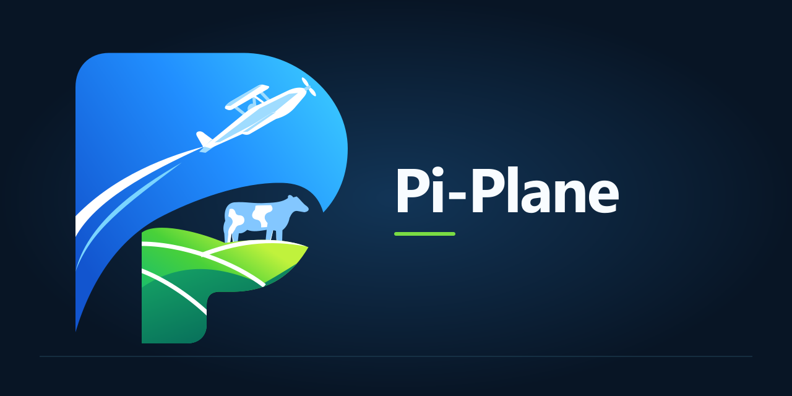

  

<b>Pi-Plane, the OSM Piątnica fork of Plane</b>

    <a href="https://github.com/OSM-Piatnica/pi-plane"><b>Repository</b></a> •
    <a href="https://github.com/OSM-Piatnica/pi-plane/issues"><b>Issues</b></a> •
    <a href="https://github.com/OSM-Piatnica/pi-plane/blob/preview/CONTRIBUTING.md"><b>Contributing</b></a> •
    <a href="https://docs.plane.so/"><b>Upstream documentation</b></a>

> [!IMPORTANT]
> **Pi-Plane (Piątnica Fork of Plane) — Work in Progress**
>
> This is an internal modified version of Plane, forked by Okręgowa Spółdzielnia Mleczarska w Piątnicy (OSM Piątnica) and tailored to our organization's needs. The project is currently under active development. It may contain experimental features or configurations specific to our environment. Feel free to explore and use it at your own risk.
>
> **Original software:**  
> Copyright (c) 2023-present Plane Software, Inc. and contributors
>
> **Modifications:**  
> Copyright (c) 2026-present Okręgowa Spółdzielnia Mleczarska w Piątnicy
>
> **File notices:**  
> Files created by Okręgowa Spółdzielnia Mleczarska w Piątnicy carry only our copyright line. Upstream files we changed keep the Plane Software notice and add a "Modified by Okręgowa Spółdzielnia Mleczarska w Piątnicy" line. Files that cannot hold comments, such as JSON locale files, carry no per-file notice; in them, Okręgowa Spółdzielnia Mleczarska w Piątnicy claims copyright only in the keys and translations it added or changed, and the rest remains under the original copyright holders' notices.
>
> All of the above is licensed under AGPL-3.0-only; see [LICENSE.txt](LICENSE.txt).

Pi-Plane is based on [Plane](https://github.com/makeplane/plane), an open-source project management tool to track issues, run ~sprints~ cycles, and manage product roadmaps without the chaos of managing the tool itself. 🧘‍♀️

## 🚀 Installation

Pi-Plane is meant to be self-hosted. For Docker Compose and Docker Swarm, follow the [Pi-Plane self-hosting guide](deployments/cli/community/README.md); for Kubernetes use the [Helm chart](deployments/helm/pi-plane/README.md). The upstream [deployment guides](https://developers.plane.so/self-hosting/overview) cover other methods, but they describe upstream Plane and may not match this fork.

| Installation methods | Docs link                                                                                                                                                                               |
| -------------------- | --------------------------------------------------------------------------------------------------------------------------------------------------------------------------------------- |
| Docker               |                                     |
| Kubernetes           |                                                                                                                               |

`Instance admins` can configure instance settings with [God mode](https://developers.plane.so/self-hosting/govern/instance-admin).

## 🌟 Features

- **Work Items**
  Efficiently create and manage tasks with a robust rich text editor that supports file uploads. Enhance organization and tracking by adding sub-properties and referencing related issues.

- **Cycles**
  Maintain your team’s momentum with Cycles. Track progress effortlessly using burn-down charts and other insightful tools.

- **Modules**
  Simplify complex projects by dividing them into smaller, manageable modules.

- **Views**
  Customize your workflow by creating filters to display only the most relevant issues. Save and share these views with ease.

- **Pages**
  Capture and organize ideas using Pages, complete with a rich text editor. Format text, insert images, add hyperlinks, or convert your notes into actionable items.

- **Analytics**
  Access real-time insights across all your data. Visualize trends, remove blockers, and keep your projects moving forward.

## 🛠️ Local development

See [CONTRIBUTING](./CONTRIBUTING.md).

## ⚙️ Built with

## 📝 Documentation

Fork-specific documentation lives in [`docs/`](docs) and in the [self-hosting guide](deployments/cli/community/README.md). For everything else, see the upstream [product documentation](https://docs.plane.so/) and [developer documentation](https://developers.plane.so/).

## ❤️ Feedback

Questions, bug reports and feature requests go to [GitHub Issues](https://github.com/OSM-Piatnica/pi-plane/issues). We follow a [Code of Conduct](CODE_OF_CONDUCT.md).

## 🛡️ Security

If you discover a security vulnerability in Pi-Plane, please report it responsibly instead of opening a public issue. See the [Security policy](SECURITY.md) for details.

## 🤝 Contributing

- Report [bugs](https://github.com/OSM-Piatnica/pi-plane/issues/new?labels=bug&template=bug-report.yaml&title=%5Bbug%5D%3A+) or submit [feature requests](https://github.com/OSM-Piatnica/pi-plane/issues/new?labels=enhancement&template=feature-request.yaml&title=%5Bfeature%5D%3A+).
- Upvote [popular feature requests](https://github.com/OSM-Piatnica/pi-plane/issues).

Please read [CONTRIBUTING.md](CONTRIBUTING.md) for details on the process for submitting pull requests.

### Thanks to the Plane contributors

Pi-Plane would not exist without the work of the people who built Plane. Thank you!

## License

This project is licensed under the [GNU Affero General Public License v3.0](LICENSE.txt).
